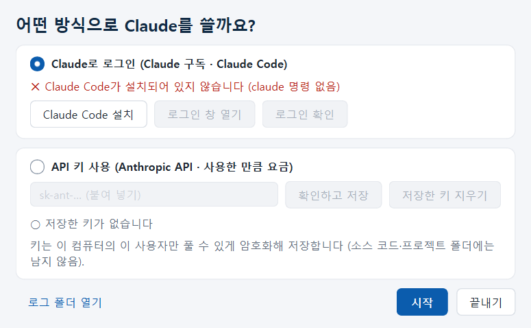
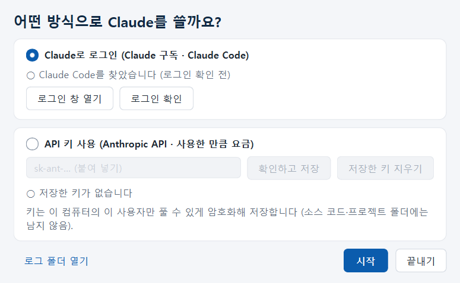
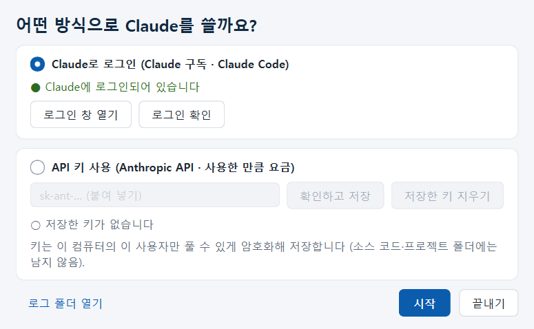

# CardTranslater 처음 설정 매뉴얼 (Claude 연결)

CardTranslater는 카드의 글자를 읽고 번역할 때 **Claude**(Anthropic의 AI)를 씁니다.
처음 켤 때 한 번, 어떤 방식으로 Claude를 쓸지 정하고 연결합니다. 이 PC에 Claude Code가 없어도 됩니다 —
프로그램이 대신 설치합니다.

> 아직 설치 전이면 [설치 매뉴얼](설치_매뉴얼.md)부터 보세요.

---

## 1. 어떤 방식을 고를까요?

| | **A. Claude로 로그인** (추천) | **B. API 키 사용** |
|---|---|---|
| 필요한 것 | Claude **유료 구독**(Pro 또는 Max) 계정 | Anthropic Console 계정 + 충전한 크레딧 |
| 요금 | 구독료 안에서 (추가 요금 없음, 대신 사용 한도가 있음) | 쓴 만큼 따로 결제 |
| 설치 | 프로그램이 Claude Code를 설치 (보통 1~5분, 약 350MB) | 설치 없음 |
| 한도에 걸리면 | 한도가 풀릴 때까지 기다렸다가 이어 하기 | 크레딧이 있는 동안 계속 |

- 무료 Claude 계정으로는 A 방식을 쓸 수 없습니다.
- 나중에 언제든 **파일 > 로그인 방식…** 에서 바꿀 수 있습니다.

---

## 2. A. Claude로 로그인 (Claude 구독)

### 2-1. Claude Code 설치 (처음 한 번)

처음 켜면 이 창이 나옵니다. **Claude로 로그인**이 골라져 있고 "Claude Code가 설치되어 있지 않습니다"가 보입니다.

1. **Claude Code 설치**를 누릅니다.
2. "Claude Code를 설치할까요?"에서 **예**를 누릅니다.
   - Anthropic 공식 사이트(downloads.claude.ai)에서 Claude Code(약 350MB)를 받아 내 사용자 폴더에 설치합니다.
     진행 창에 "Claude Code 받는 중… 120 / 345 MB"처럼 나옵니다.
   - 관리자 권한은 필요 없습니다. 보통 **1~5분** 걸리니 진행 창이 끝날 때까지 기다립니다.
   - 공식 사이트에 연결되지 않으면 Node.js와 npm으로 대신 설치합니다 (더 오래 걸립니다).
   - 백신이나 방화벽이 묻는 창이 나오면 **허용**합니다.
3. "설치했습니다"가 나오면 **확인**. 이제 버튼이 **로그인 창 열기 / 로그인 확인**으로 바뀝니다.

### 2-2. Claude 계정으로 로그인 (처음 한 번)

1. **로그인 창 열기**를 누릅니다. **검은 창**(명령 프롬프트)이 새로 열리고, 맨 위에 한글 안내가 나온 뒤
   Claude Code가 시작됩니다.
   - 이 창의 글은 **영어**입니다. 아래 순서대로 고르기만 하면 됩니다.
   - 키보드 **↑ ↓** 로 고르고 **Enter**로 정합니다.
2. Claude Code를 처음 켜면 안내가 차례로 나옵니다 (버전에 따라 문구·순서가 조금 다를 수 있습니다).

   | 검은 창에 나오는 것 | 할 일 |
   |---|---|
   | 글자 색(테마) 고르기 (`Choose the text style…`) | 아무거나 골라 **Enter** |
   | 로그인 방법 고르기 (`Select login method`) | **`Claude account with subscription`** 을 골라 **Enter** |
   | 브라우저가 열리고 Claude 로그인 화면 | 구독한 계정으로 로그인 → **승인(Authorize)** |
   | 브라우저에 코드가 보이고 검은 창이 `Paste code here` | 브라우저의 코드를 복사(Ctrl+C) → 검은 창에서 **마우스 오른쪽 클릭**(붙여 넣기) → **Enter** |
   | `Login successful` | **Enter** |
   | 안내 글(`Security notes` 등) | **Enter** |
   | 이 폴더를 믿을지 (`Do you trust the files in this folder?`) | **Yes** 를 골라 **Enter** |
   | `>` 입력 칸이 나옴 | 로그인 끝. 창을 닫거나 `/exit` 입력 후 **Enter** |

   - 이미 안내를 지나왔는데 로그인이 안 되어 있으면, `>` 입력 칸에 **`/login`** 을 입력하고 **Enter**를 눌러
     위의 "로그인 방법 고르기"부터 합니다.
   - 브라우저가 저절로 열리지 않으면, 검은 창에 보이는 `https://…` 주소를 복사해 브라우저에 붙여 넣습니다.
   - 다른 계정으로 잘못 로그인했으면 `>` 에서 `/logout` 한 뒤 `/login` 을 다시 합니다.
3. CardTranslater 창으로 돌아와 **로그인 확인**을 누릅니다.
   - 아주 짧은 요청을 한 번 보내 확인합니다 (사용량이 아주 조금 듭니다).
   - 초록색 **"● Claude에 로그인되어 있습니다"** 가 나오면 성공입니다.

4. **시작**을 누릅니다.

> 다음부터는 켤 때 이 창에서 **시작**만 누르면 됩니다. Claude 로그인은 이 PC에 남아 있습니다.

---

## 3. B. API 키 사용

1. 브라우저에서 **https://console.anthropic.com** 에 가입하고 로그인합니다.
2. **Billing(결제)** 에서 결제 수단을 넣고 크레딧을 충전합니다 (충전한 만큼만 쓸 수 있습니다).
3. **API Keys** 에서 **Create Key**를 눌러 키를 만들고 **복사**합니다.
   - `sk-ant-` 로 시작하는 긴 글입니다. 이 화면을 닫으면 다시 볼 수 없으니 바로 복사하세요.
4. CardTranslater 창에서 **API 키 사용**을 고르고, 키 칸에 붙여 넣은 뒤(Ctrl+V) **확인하고 저장**을 누릅니다.
   - 키가 맞는지 확인하고 이 PC에 **암호화해** 저장합니다. 초록색 "● 키 있음"이 나오면 성공입니다.
5. **시작**을 누릅니다.

> 키는 비밀번호와 같습니다. 다른 사람에게 보내거나 공유 폴더에 두지 마세요. 필요 없어지면 **저장한 키 지우기**.

---

## 4. 시작한 뒤 확인할 것

| 무엇 | 어디서 |
|---|---|
| 어떤 방식으로 연결됐나 | 창 맨 아래 상태 줄: "Claude 구독으로 실행 (Claude Code)" 또는 "API 키로 실행" |
| 프로젝트를 둘 폴더 | **파일 > 설정…** 의 데이터 폴더 (기본 `문서\CardTranslater`) |
| 글꼴이 다 설치됐나 | ⑧ 한글 넣기의 글꼴 고르기 창 위에 "글꼴이 설치되어 있지 않아…" 안내가 **없으면** 정상 |
| 로그인 방식 바꾸기 | **파일 > 로그인 방식…** |

이제 **＋ 새 프로젝트**로 시작하면 됩니다.

---

## 5. 문제가 생기면

| 증상 | 해결 |
|---|---|
| **Claude Code 설치**가 실패한다 | 인터넷 연결을 확인하고 다시 누릅니다. 회사·학교 네트워크(프록시)나 백신이 막는 경우가 있습니다 → 다른 네트워크에서 해 보거나, B(API 키) 방식을 씁니다 |
| "Git for Windows가 필요합니다" 라고 나온다 (또는 검은 창에 `git-bash` 오류) | **Git for Windows**(https://git-scm.com/download/win)를 받아 모두 기본값으로 설치한 뒤 CardTranslater를 다시 켭니다 |
| **로그인 창 열기**를 눌렀는데 검은 창이 바로 닫힌다 / 다른 오류가 난다 | 검은 창의 오류 글을 사진으로 남겨 보내 주세요 |
| **로그인 확인**에서 "로그인되어 있지 않습니다" | **로그인 창 열기** → `>` 에서 `/login` → 2-2를 다시 합니다 |
| "사용 한도" 라고 나온다 | 로그인은 된 것입니다. Claude 구독의 사용 한도에 걸린 것이므로, 표시된 시각 뒤에 같은 단계를 다시 누르면 이어서 합니다 |
| 무료 계정이라 로그인 뒤에도 안 된다 | Claude Code는 유료 구독(Pro·Max)이 필요합니다. 구독하거나 B(API 키)를 씁니다 |
| API 키를 저장하지 못했다 | 키를 처음부터 끝까지 다시 복사합니다 (앞뒤가 잘리지 않게). Console에 크레딧이 있는지 확인합니다 |
| Claude Code 없이 그냥 시작했다 | 영역 지정·지우기·한글 넣기·결과 보기는 되지만 글자 추출·번역은 안 됩니다. **파일 > 로그인 방식…** 에서 설정합니다 |

해결되지 않으면 **도움말 > 로그 묶어서 저장…** 으로 만든 zip 파일과, 어느 단계에서 무엇이 나왔는지(화면 사진)를
함께 보내 주세요. API 키는 가려서 저장되므로 안심하고 보내도 됩니다.
